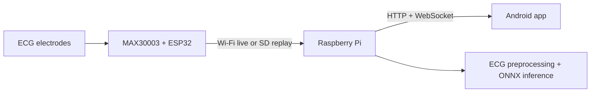

# AFib Forecast — Android app

Android interface for a Raspberry Pi edge-computing research prototype that analyzes single-lead ECG for an elevated atrial fibrillation forecast score. The intended model input is a **10-minute ECG observation**; its forecast horizon is the **following 20 minutes**. The phone displays the Pi's results and does not run the model itself.

> **Research prototype:** A score is not a diagnosis or a clinical emergency alert. Pre-recorded demonstrations are explicitly labeled and must not be presented as a person's own ECG result.

## What the app does

- Shows the Pi and ECG/replay device connection states and the physical signal mode.
- Offers **Live testing** for ongoing ECG acquisition and **AF simulation** for POS102/NEG024 recordings stored on the ESP32's SD card.
- Shows a live timer that ticks between Pi updates, completion percentage, and progressing dots. The Pi's received samples and valid segments remain authoritative for inference.
- Presents the model score only after a complete result arrives. An elevated score (at or above the Pi-supplied threshold) appears in red; a missing threshold is not interpreted.
- Saves completed session summaries locally on the phone across app restarts.
- Stores emergency contact numbers locally and opens an SMS composer for the user to review and send. The app does not send SMS automatically.
- Includes a labeled presentation fixture for UI review without hardware.

## System boundary

This directory contains the **Android client source and API contract**. It does not contain the Pi receiver, Pi bridge, model weights, patient datasets, or ESP32 firmware. Those are separate deployment components. The live and replay paths both require a working Pi service; the presentation fixture is only a UI demonstration.

## Build and run

1. Open this `android/` folder (the one containing `settings.gradle.kts`) in Android Studio.
2. Let Gradle sync. Use a device running Android 8.0 (API 26) or newer. The project targets API 36.
3. Select the `app` configuration and press **Run**. For a command-line debug build on Windows, run `gradlew.bat assembleDebug`; on macOS/Linux, run `./gradlew assembleDebug`.
4. For real hardware, connect the phone and Pi to the same trusted hotspot or local Wi-Fi. On the Pi, run the existing receiver and `pi_app_bridge.py` service. Find its IP address with `hostname -I`.
5. In the app, open the connection control, enter `http://<PI_IP>:8080`, switch off **Presentation simulation**, and connect. Select the mode matching the physical ESP32 mode.

For live acquisition, the Pi's live receiver and bridge run in separate terminals. For SD replay, the bridge starts the replay receiver and inference script after **Start AF simulation** is tapped. POS102 and NEG024 are historical recordings; their transfer may finish faster than ten minutes. A live observation requires ten minutes of acquired ECG.

The app's default URL, `http://192.168.4.1:8080`, is an example and must be changed when the Pi has a different IP. A basic bridge check is `http://<PI_IP>:8080/api/v1/status`.

## Project structure

- `app/src/main/java/com/afibforecast/app/` — Compose UI, state, event parser, Pi client, and local history storage.
- `app/src/main/AndroidManifest.xml` — Android application and permissions.
- `PI_API_CONTRACT.md` — implemented Pi-to-app endpoints and event fields.
- `../docs/APP_AND_ENCLOSURE.md` — integration and mechanical design notes.

## Network and data notes

The development bridge listens on the local network and the Android app allows cleartext HTTP for the trusted hotspot demo. Do not expose this bridge to the public Internet without access control and TLS. Session history and contact numbers are stored on the phone; uninstalling or clearing app data removes them.

The app displays a result from the Pi and cannot verify a medical diagnosis. For body-connected recording, use an isolated battery-powered ECG board; do not charge or attach USB equipment while electrodes are connected.

## Version

Android app source: **1.4.10**. This directory includes source, not a signed release APK. Build and test it on your own Android device and Pi setup before demonstrating it.
